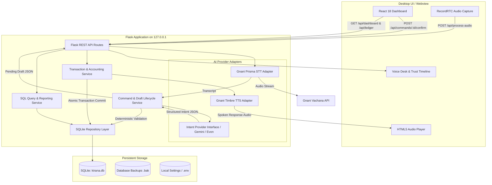
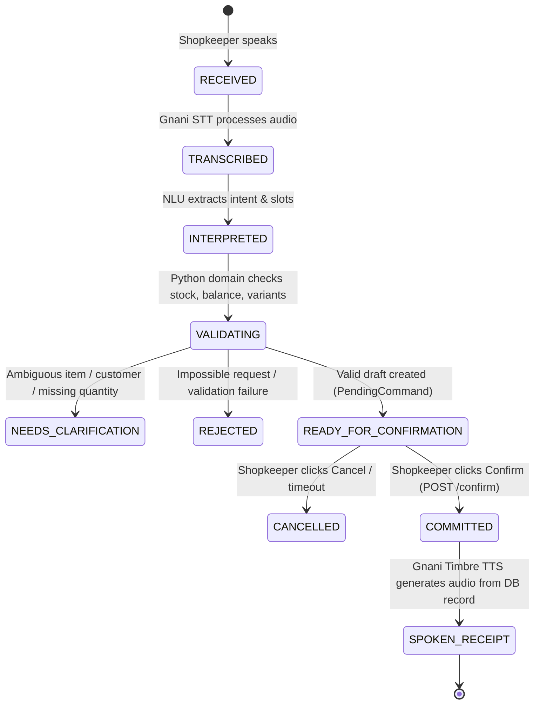

# KiranaSync 2.0 Technical Architecture

## 1. System Overview

KiranaSync 2.0 is built as a local-first desktop application with a split client-server architecture:
- **Presentation**: React 18, Vite, Tailwind CSS, Framer Motion, running within a native PyWebView window or modern browser.
- **Backend API & Domain Engine**: Python Flask application running locally on `127.0.0.1:5000`.
- **Database**: Embedded SQLite (`kirana.db`) with Write-Ahead Logging (WAL) and atomic transactions.
- **External AI Providers**:
  - **STT**: Gnani Prisma STT (`https://api.vachana.ai/stt/v3`) for Indian-language & code-mixed voice recognition.
  - **NLU / Reasoning**: Model-agnostic intent interface (`gemini-3.5-flash-lite` baseline; modular adapter for `gnani-evon-v3.3`).
  - **TTS**: Gnani Timbre TTS (`https://api.gnani.ai/v1/tts/inference`) for verified spoken receipts.

---

## 2. Component Diagram

---

## 3. The Trust Engine Lifecycle

Every voice command transitions through a strictly enforced state machine:

---

## 4. Database Schema Design (KiranaSync 2.0)

### Table: `Inventory`
- `ItemID` INTEGER PRIMARY KEY AUTOINCREMENT
- `ItemName` TEXT NOT NULL UNIQUE
- `Category` TEXT
- `StockQuantity` INTEGER NOT NULL DEFAULT 0
- `SellingPrice` REAL NOT NULL DEFAULT 0.0 *(Formerly `Price`)*
- `MRP` REAL DEFAULT NULL
- `PurchaseCost` REAL DEFAULT NULL
- `Unit` TEXT DEFAULT 'packet'
- `ReorderLevel` INTEGER DEFAULT 5

### Table: `CustomerCredit`
- `CustomerID` INTEGER PRIMARY KEY AUTOINCREMENT
- `CustomerName` TEXT NOT NULL UNIQUE
- `PhoneNumber` TEXT
- `OutstandingBalance` REAL NOT NULL DEFAULT 0.0

### Table: `Transactions`
- `TxnID` INTEGER PRIMARY KEY AUTOINCREMENT
- `Timestamp` DATETIME DEFAULT CURRENT_TIMESTAMP
- `CommandText` TEXT NOT NULL
- `TotalAmount` REAL NOT NULL
- `TransactionType` TEXT NOT NULL *(Sale, Restock, UdhaarSale, Repayment, Reversal, Adjustment)*
- `EntityName` TEXT
- `Quantity` REAL
- `CustomerID` INTEGER REFERENCES CustomerCredit(CustomerID)
- `CommandID` TEXT UNIQUE *(Idempotency key)*
- `IsReversed` BOOLEAN DEFAULT 0
- `ReversalOfTxnID` INTEGER REFERENCES Transactions(TxnID)

### Table: `PendingCommands`
- `CommandID` TEXT PRIMARY KEY
- `CreatedAt` DATETIME DEFAULT CURRENT_TIMESTAMP
- `ExpiresAt` DATETIME NOT NULL
- `Operation` TEXT NOT NULL
- `PayloadJSON` TEXT NOT NULL
- `Status` TEXT NOT NULL *(PENDING, COMMITTED, CANCELLED, REJECTED)*
- `CommittedTxnID` INTEGER REFERENCES Transactions(TxnID)

### Table: `Aliases`
- `AliasID` INTEGER PRIMARY KEY AUTOINCREMENT
- `EntityType` TEXT NOT NULL *(Product, Customer)*
- `EntityID` INTEGER NOT NULL
- `SpokenAlias` TEXT NOT NULL UNIQUE
- `IsApproved` BOOLEAN DEFAULT 1

---

## 5. Security & Isolation
- **Loopback Binding**: Flask runs strictly on `127.0.0.1`.
- **Zero Secret Exposure**: API keys are accessed solely via backend environment variables; no key is ever sent to the browser bundle, stored in client logs, or displayed in debug strings.
- **Collision Protection**: Audio uploads use `tempfile.NamedTemporaryFile` with guaranteed cleanup in `try...finally`.
- **Atomic Operations**: Database modifications wrap inventory, customer balance, and ledger row insertions in `BEGIN IMMEDIATE TRANSACTION` blocks.
